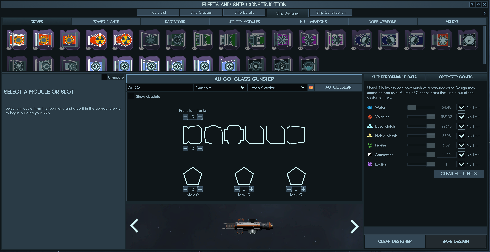

# Ship Optimizer Config

A Terra Invicta mod that lets you tell the ship designer's **Auto Design** button what it's allowed to spend.

Out of the box, Auto Design picks the best parts it can find for the hull and role you've chosen, and it happily uses exotics, antimatter or a pile of noble metals you don't have. This mod adds an **Optimizer Config** tab next to Ship Performance Data where you can cap each resource, so you get the best design you can actually build.



## Features

- A limit for each ship-building resource: water, volatiles, metals, noble metals, fissiles, antimatter and exotics
- Set a limit with the slider (0 up to your current stockpile) or type any amount into the box
- **No limit** (the default) leaves a resource alone, so with nothing set Auto Design behaves exactly like the base game
- A limit of **0** keeps every part that uses that resource out of the design, e.g. an exotics-free Titan
- If the limits can't be met, you get a message explaining why, and the limits that were too tight are raised to the minimum that works. Press Auto Design again to use them
- Hull, role and the game's own design logic are untouched; the mod only narrows which parts Auto Design may pick
- Settings are remembered between sessions and are not stored in your save games

## Installation

The mod needs [Unity Mod Manager](https://www.nexusmods.com/site/mods/21) (UMM), version 0.24 or later.

You can either subscribe on the [Steam Workshop](https://steamcommunity.com/sharedfiles/filedetails/?id=3818080267) or install it by hand from GitHub. Both need UMM.

1. **Install UMM for Terra Invicta.** Run UnityModManager.exe, pick Terra Invicta from the list, choose the **DoorstopProxy** method and click Install.
   - On Linux/Steam Deck (Proton), also set this Steam launch option for Terra Invicta:
     `WINEDLLOVERRIDES="winhttp=n,b" %command%`
     UMM's installer needs mono on Linux (`mono Console.exe` from the UMM folder works).
2. **Subscribe** on the Workshop and skip to step 4, or **download** `ShipOptimizerConfig.zip` from the [latest release](https://github.com/jingo64/ship-optimizer/releases/latest).
3. **Extract** it into `Terra Invicta/Mods/Enabled/`, so you end up with `Mods/Enabled/Ship Optimizer/ShipOptimizerConfig.dll` and `ModInfo.json`.
4. Start the game. Ship Optimizer Config should appear in the UMM window (Ctrl+F10).

To uninstall, unsubscribe (or delete the `Ship Optimizer` folder), or switch the mod off in UMM.

## Usage

1. Open **Fleets → Ship Designer**, pick a hull and a role as usual.
2. Click the **Optimizer Config** tab in the panel on the right.
3. Untick **No limit** next to anything you want to restrict, then set the amount. Slide it to 0 to leave that resource out completely.
4. Press **Autodesign**.

**Clear all limits** puts every resource back to No limit.

A few things worth knowing:

- Crew always need some water and volatiles, so a 0 on those only removes parts and propellant that use them.
- Auto Design swaps parts to get under a limit, but it won't thin your armour or change the hull, so a very tight limit on a big hull may come back as "raised the limit".
- Refits aren't affected. Refit Auto Design works as it always has.

## Compatibility

Tested on Terra Invicta 1.0.53b. It patches the ship designer's Auto Design button and nothing else, so it should get along with other mods unless they also replace Auto Design. Save games are unaffected, and you can remove the mod at any time.

## Building from source

You need the .NET SDK (6.0 or later; the project targets .NET Framework 4.8 through reference packages) and an installed copy of the game with UMM.

```sh
dotnet build -c Release -p:TIGame="/path/to/Terra Invicta" -p:Deploy=true
```

`TIGame` points at your game folder (the default in the project file is a Steam on Linux path). `-p:Deploy=true` copies the built mod straight into `Mods/Enabled`.

## Feedback

Bug reports and suggestions are welcome in [Issues](https://github.com/jingo64/ship-optimizer/issues). If something goes wrong, UMM's log (`TerraInvicta_Data/Managed/UnityModManager/Log.txt`) is the most useful thing to attach.

## License

MIT, see [LICENSE](LICENSE).
